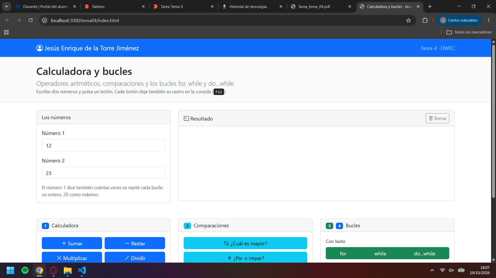
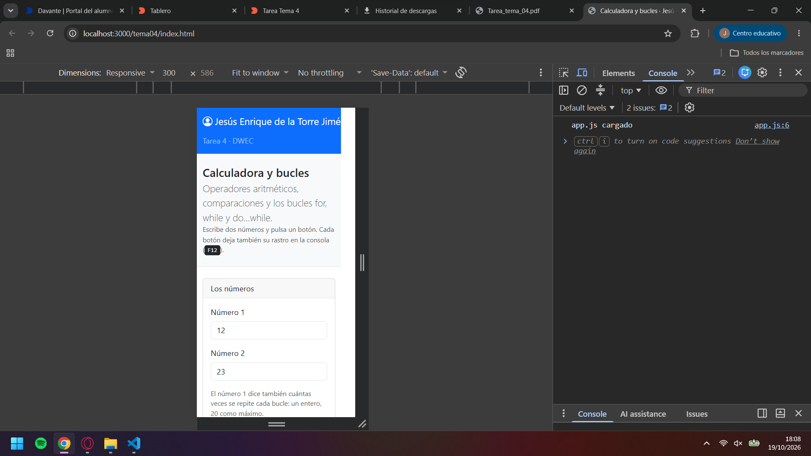
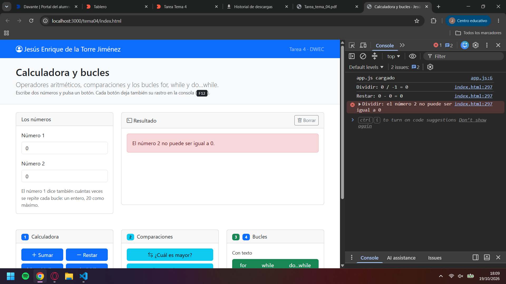
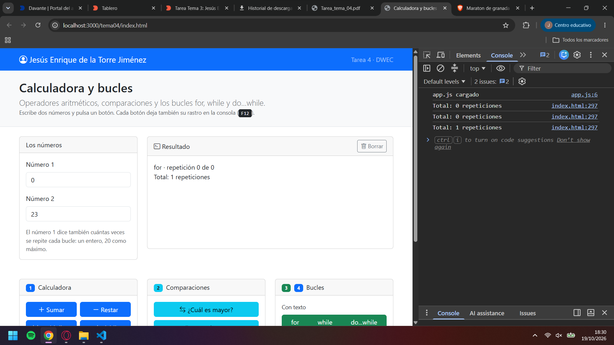
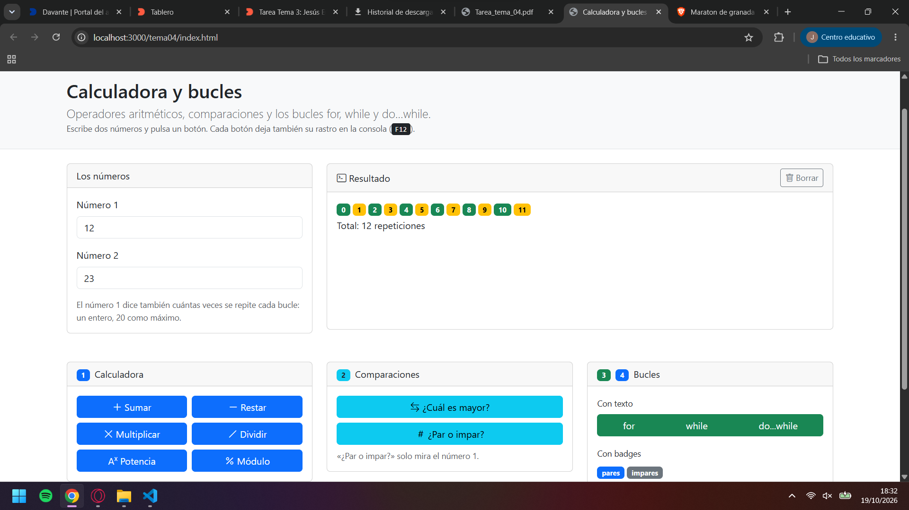

# Tarea 4 · Calculadora y bucles

**Autor:** Jesús Enrique de la Torre Jiménez · Desarrollo Web en Entorno Cliente (DWEC) · 2.º DAW · Curso 2026-27

En la carpeta se ubica la página web index.html y la carpeta con los archivos .js. Para probar la funcionalidad de la app, usamos la extensión "Liveserver" en el archivo html, ejecutamos las operaciones que queramos hacer y vemos los resultados tanto en la página como en la consola de desarrolladores.

## Capturas

### a) La página entera

En la página principal se ve el navbar con la mi nombre y el contenido principal de la página web.

### b) La página en el móvil

Al cambiar la página al modo móvil, se reconfigura la disposición de los elementos en la página, ubicándolos en filas con solo una carta por cada una.

### c) El error de dividir entre 0

Se muestra en la sección de resultados un aviso de error. El la consola vemos un error con el mansaje correspondiente.

### d) Los tres bucles con el número 0

[Cuántas veces se repite cada bucle y por qué.]
Tanto en el bucle for como while no se realiza ninguna iteración ya que comprueban que no tienen que realizar el bucle. El bucle do...while, ejecuta el bucle una vez ya que se ejecuta el contenido antes de la comprobación lógica.

### e) Un bucle con badges

El número elegido es el 12, para elegir el color del badge, hago una operación tenaria y compruebo si el número es comprobando si el resultado de mod(2) es 0 o 1 indicando si es par o impar.

## Reflexión

Cuando el número de iteraciones es conocido, utilizamos el for pasando los parámetros correspondientes. En caso de necesitar que se cumpla una condición antes de salir del bucle utilizariamos la estructura while. En este, no se sabe el número de iteraciones completas sino que, en cada una, se comprueba la condición lógica. El bucle do...while hace la misma función lógica que el bucle while, con la excepción de realizar una iteración antes de la comprobación lógica. Esto es util cuando necesitamos que se ejecute mínimo una vez el bucle como la comprobación de una contaseña que hay que insertar antes de comprobar. En el ejemplo de iterar 0 veces el bucle, tanto el bucle while como el for no se ejecutan. Mientras que el bucle do...while, ejecuta una vez la función antes de comprobar cuantas iteraciones tenia que hacer.

## Uso de IA

Se ha hecho uso de la IA para la parte la ayuda en la creación del archivo index.html.

Herramienta: Qwen 3.7 plus
