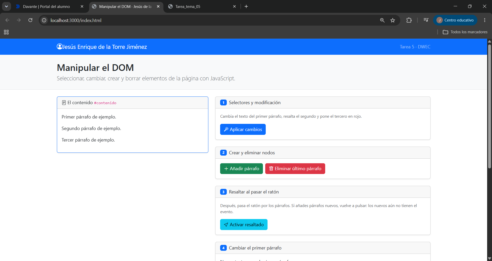
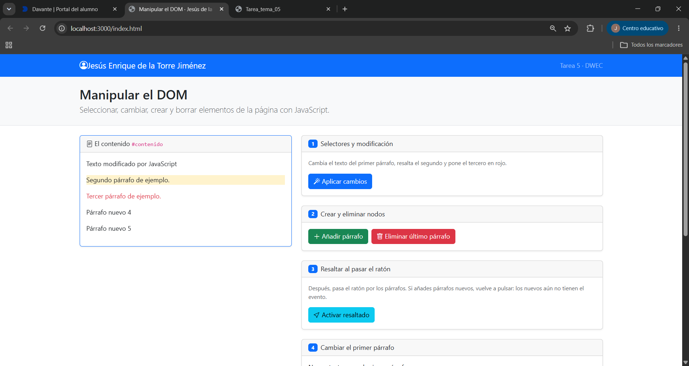
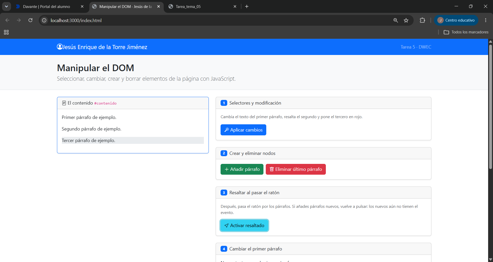
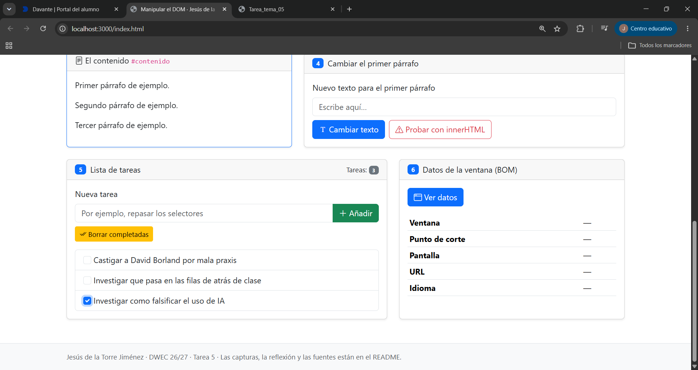
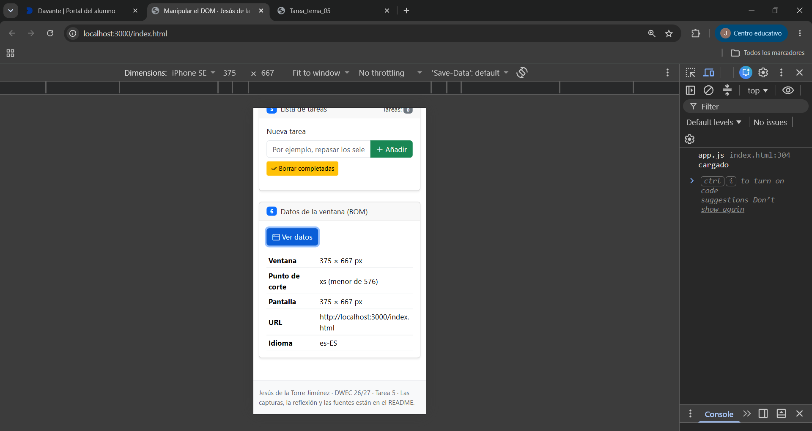

# Tarea 5 · Manipular el DOM

**Autor:** Jesús de la Torre Jiménez · Desarrollo Web en Entorno Cliente (DWEC) · 2.º DAW · Curso 2026-27

Al abrir la carpeta en VS Code, pulsar **Go Live** y probar los botones con la consola abierta (F12). La estructura está dividida en un archivo index.html, una carpeta con las capturas y la carpeta de js con el código javascript.

## Capturas

### a) La página recién cargada

Se ve mi nombre y los 4 apartados de funciones ademas del área de contenido.

### b) Ejercicios 1 y 2

En el primer párafo se ha cambiado el texto entero dentro de él. En el segundo párafo se ha cambiado la clase por "bg-warning-subtle" y en el tercero se ha añadido la clase "text-danger". Para el selector del primero getElementById, el segundo querySelector y el tercero querySelectorAll.

### c) Ejercicio 3: resaltado al pasar el ratón

Está resaltado el 3 párafo. Los párrafos que se añaden después, no se resaltan ya que "addEventListener" solo se aplica a los contenidos que hay en la página a la hora de hacer la función.

### d) Ejercicio 4: `<b>hola</b>` con innerHTML

Al usar la función de cambiar texto, nos sale `<b>hola</b>` con formato plano. Al usar innerHTML lo ejecuta como si fuera una estructura HTML y nos sale hola en negrita.

### e) Ejercicio 5: la lista de tareas

En la lista aparecen tres elementos en la lista de tareas. Cada una tiene un checkbox con la habilidad de marcarlo.

### f) Ejercicio 6: los datos de la ventana en el móvil

En la vista de móvil, nos sale el punto de corte xs(menor de 576 píxeles), en el ordenador nos sale el tamaño más grande xxl.

## Reflexión

La diferencia entre textContent e innerHTML es como interpreta el contenido añadido. Al usar textContent, añade el contenido como texto plano independientemente de los carácteres empleados. Sin embargo, al usar innerHTML, javascript interpreta las esturcturas HTML y las inserta como tal en la página web. Este caso lo hemos visto al probar a introducir `<b>hola</b>` con ambos métodos. El primero aparece como tal esrito, en el segundo se ejecuta como HTML. El peligro del permitir al usuario mandar contenido a innerHTML son los posibles ataques XSS. Si un usuario añade scripts maliciosos el script lo ejecutará automaticamente permitiendo inyectar código y robar coockies, quitar acceso a los usuarios o suplantar la identidad.
