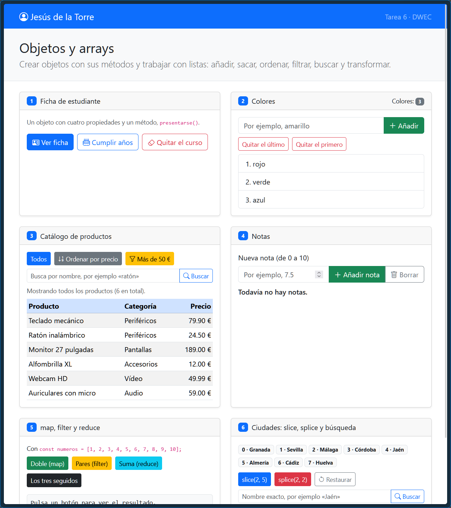
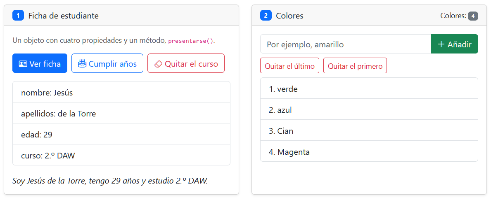
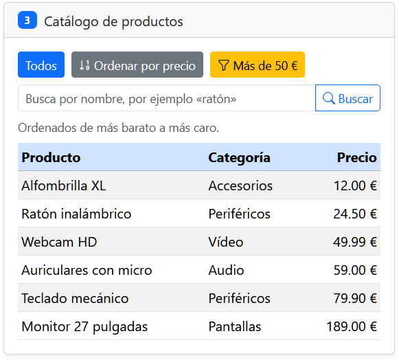
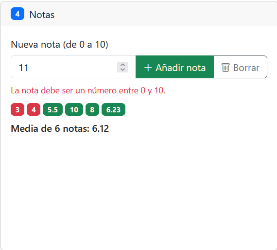
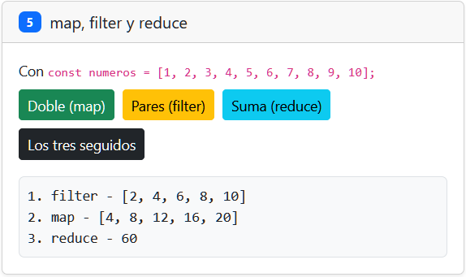
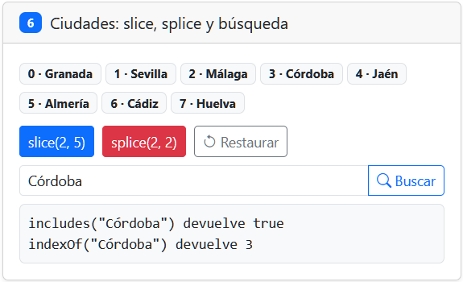

# Tarea 6 · Objetos y arrays

**Autor:** Jesús de la Torre · Desarrollo Web en Entorno Cliente (DWEC) · 2.º DAW · Curso 2026-27

Esta carpeta contiene la implementación de los seis ejercicios prácticos sobre manipulación de objetos y arrays en JavaScript. Para visualizar la aplicación y comprobar su funcionamiento, basta con abrir el proyecto en VS Code, iniciar el servidor con Go Live y probar las acciones con la consola de desarrollo abierta (F12).

## Capturas

### a) La página recién cargada

En la página vemos el nombre, y el contenido principal con los 6 apartados de la página web. 

### b) Ejercicios 1 y 2: la ficha y los colores

En la ficha tras incrementar la edad con el botón y lista de colores tras añadir con push() y extraer elementos mediante pop() y shift().

### c) Ejercicio 3: el catálogo ordenado por precio

La función compara por precio restando a.precio - b.precio para ordenar de menor a mayor. Se ordena una copia ([...productos]) para no modificar el orden original del array con sort().

### d) Ejercicio 4: las notas y la media

En la imagen vemos como, depende de si es aprobado o suspenso, la nota se muestra con un color rojo (suspenso) o verde (aprovado). La media se calcula según los valores de las notas y se muestra en texto abajo.

### e) Ejercicio 5: los tres métodos seguidos

Filter selecciona solo los números pares, map calcula el doble de cada uno y reduce suma todos los valores resultantes. El número final obtenido es 60.

### f) Ejercicio 6: después de splice y de buscar una ciudad

Splice(2, 2) ha eliminado Málaga y Córdoba del array original. Al buscar Jaén queda en la posición 2 (antes estaba en la 4) porque los elementos posteriores se reindexan.

## Reflexión

Los métodos que cambian el contenido del array original son push, pop, shift, splice y sort. Estos modifican directamente los elementos de la estructura inicial.

Por el contrario, los métodos como slice, map y filter no cambian el array original sino que devuelven uno nuevo con los resultados del método sobre el array original.

En el ejercicio 6, slice(2, 5) nos devuelve un trozo pero el array de ciudades sigue teniendo las 8 que había al principio. En cambio, cuando usamos splice(2, 2), sí que quita esas dos ciudades y el array pasa a tener 6.

Por eso mismo en el ejercicio 3 hacemos una copia con [...productos] antes de usar sort(). Como sort() modifica el array sobre el que se aplica, si no hiciéramos la copia perderíamos el orden inicial que tenía la lista de productos.

## Fuentes

- [MDN Web Docs - Array](https://developer.mozilla.org/es/docs/Web/JavaScript/Reference/Global_Objects/Array)

## Uso de IA

Se ha utilizado Gemini para resolver dudas puntuales sobre la sintaxis, métodos de arrays y la estructura de los ejercicios del tema 6 y para mejorar el README.
