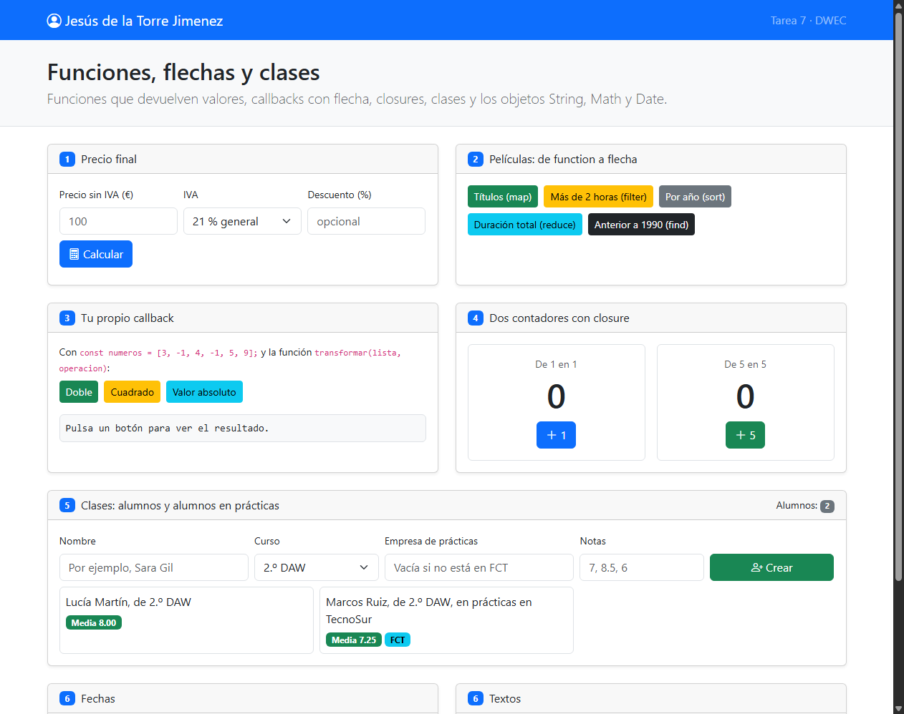
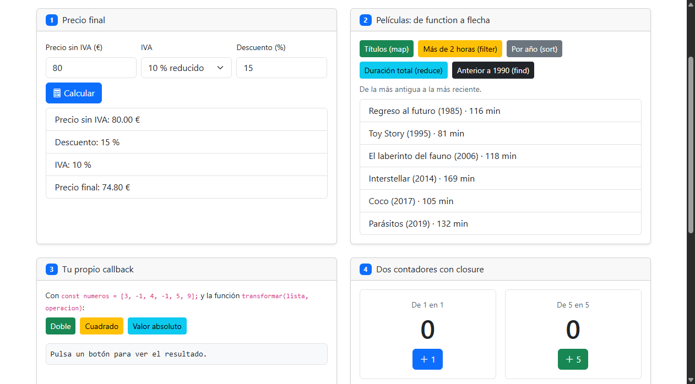
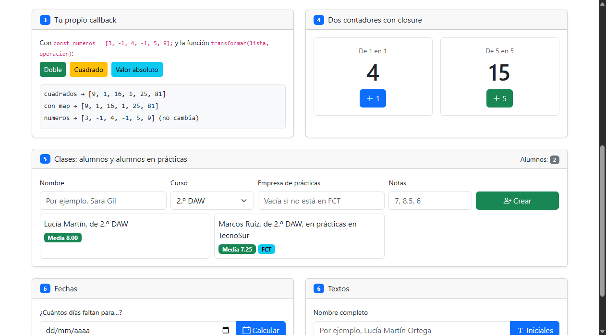
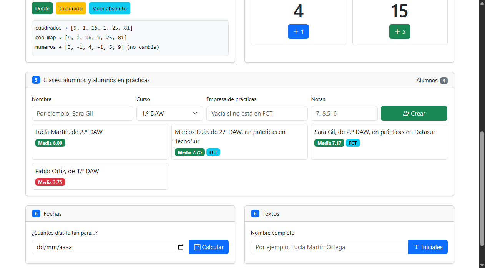

# Tarea 7 · Funciones, flechas y clases

**Autor:** Jesús de la Torre Jimenez · Desarrollo Web en Entorno Cliente (DWEC) · 2.º DAW · Curso 2026-27

En esta práctica se resuelven seis ejercicios sobre funciones, callbacks con flecha, closures y clases en JavaScript. Para visualizar el proyecto se puede abrir la carpeta en VS Code y ejecutar el archivo index.html en el navegador.

## Capturas

### a) La página recién cargada

Al cargar la página se muestra mi nombre en la barra superior de navegación y los dos alumnos creados por defecto en la sección de clases con sus respectivas notas y medias calculadas.

### b) Ejercicios 1 y 2: el precio y las películas

En el primer ejercicio la función calcularPrecio calcula el coste final restando el descuento y sumando el IVA, mientras que mostrarPrecio valida las entradas del usuario y dibuja el desglose. En el segundo ejercicio se muestran las películas ordenadas cronológicamente utilizando sort con una función flecha.

### c) Ejercicios 3 y 4: tu callback y los contadores

La función transformar recorre el array original con un bucle for of y aplica la función recibida por argumento a cada número sin modificar la lista original. Por otro lado, los contadores funcionan con un closure que encapsula la variable cuenta para cada llamada a crearContador, de forma que cada uno mantiene su propio estado de forma independiente.

### d) Ejercicio 5: los alumnos

Aquí se visualizan cuatro alumnos dados de alta, dos de ellos en prácticas de empresa. La función crearAlumno comprueba si el campo de empresa tiene texto para instanciar un AlumnoFCT o, en caso de estar vacío, una instancia básica de Alumno.

### e) Ejercicio 6: fechas y textos

Para probar las fechas se ha seleccionado el 25 de diciembre de 2026 y el sistema calcula los días restantes redondeando con Math.round para compensar posibles desfases por el cambio horario. En la parte de textos se introdujo un nombre con espacios dobles para extraer las iniciales y generar el identificador de usuario con tres cifras aleatorias.

## Reflexión

Al pasar un callback de function a flecha conseguimos una sintaxis más limpia y que el valor de this se mantenga del contexto exterior. El return explícito solo es necesario cuando el cuerpo de la función flecha tiene llaves y contiene varias instrucciones; si el cuerpo es una única expresión, el retorno es implícito, como en peliculas.map((pelicula) => pelicula.titulo). Por el contrario, los métodos dentro de una clase no deben escribirse con funciones flecha porque necesitan vincular dinámicamente su propio this a la instancia creada, como sucede en el método presentarse de la clase Alumno. Escribirlos con la sintaxis tradicional de método garantiza que accedan correctamente a las propiedades del objeto.

## Fuentes

- [MDN Web Docs - Funciones flecha](https://developer.mozilla.org/es/docs/Web/JavaScript/Reference/Functions/Arrow_functions)
- [MDN Web Docs - Clases](https://developer.mozilla.org/es/docs/Web/JavaScript/Reference/Classes)
- [MDN Web Docs - Closures](https://developer.mozilla.org/es/docs/Web/JavaScript/Closures)

## Uso de IA

Se ha usado Gemini 3.8 Flash como apoyo para consultar la sintaxis de métodos nativos y organizar la redacción de las explicaciones, comprobando y ajustando el código y las capturas personalmente.
