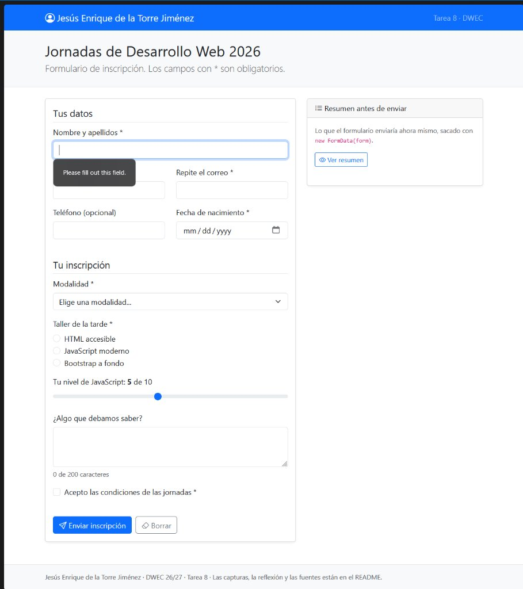
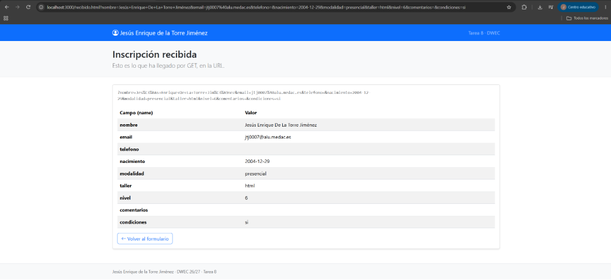

# Tarea 8 · Formulario de inscripción

**Autor:** Jesús Enrique de la Torre Jiménez · Desarrollo Web en Entorno Cliente (DWEC) · 2.º DAW · Curso 2026-27

Formulario de inscripción a las «Jornadas de Desarrollo Web 2026» maquetado con Bootstrap, validado con HTML5 y JavaScript y enviado por GET a `recibido.html`. Para probarlo, abrir la carpeta en VS Code con **Live Server** y usar la consola del navegador (F12).

## Capturas

### a) La página recién cargada

En la captura vemos el nombre y el formulario completo con dos fieldsets.

### b) Ejercicio 2: el mensaje del navegador

El campo que falla es el primero de Nombre y apellidos al ser obligatorio y no estar relleno. Cuando quitamos la propiedad `required` desde la consola de desarrollador, los datos se envían aun estando vacíos. Es por ello que tenemos que validar siempre los datos en el servidor, ya que las restricciones puestas en el front-end son sujetas a modificaciones por el usuario.

### c) Ejercicio 3: lo que llega por GET

Al hacer un GET, se mandan todos los datos del formulario por la URL, a excepción del campo de repetir el correo, que no llega porque no tiene atributo `name`. Nunca enviaríamos una contraseña por GET porque sería visible en la barra de direcciones y estaría expuesta en el historial y en los registros.

### d) Ejercicio 4: los errores, junto a cada campo

Al enviar con `novalidate`, JavaScript muestra cada error junto a su campo: en Nombre (`tooShort`) y Correo (`typeMismatch`) salen mensajes propios de `mensajeDe()`; en Teléfono (`patternMismatch`) y Fecha de nacimiento (`rangeOverflow`) se usa el `title` del campo; y en los campos vacíos (Repite el correo, Modalidad y Taller) se muestran los textos del objeto `OBLIGATORIOS` (`valueMissing`).

### e) Ejercicios 5 y 6: eventos y resumen

Se ve el contador (`77 de 200 caracteres`) y el nivel (`8 de 10`) actualizados con el evento `input`, el error «Los dos correos no coinciden.» generado con `setCustomValidity`, y el resumen creado con `new FormData(form)` con 7 datos (sin «Repite el correo» porque no tiene `name` y marcando como `(vacío)` los campos sin rellenar).

## Reflexión

Al validar los datos desde JavaScript y no solo con el navegador podemos comprobar antes de enviar al servidor fallos más complejos, mostrar todos los errores a la vez junto a su campo y facilitar al usuario introducir datos correctos. Aun así, las verificaciones hechas antes del envío al back-end son para ayudar al usuario y no sirven como comprobación definitiva, ya que pueden ser editadas desde el navegador insertando datos no válidos.

Si intentamos usar `this` en el manejador del `submit` usando una función flecha, `this` no apunta al formulario sino a `window` (porque las flechas heredan el `this` del ámbito exterior). Por eso hay que utilizar `e.target` o la constante `form`.

## Fuentes

- [Validación de datos de formulario · MDN Web Docs](https://developer.mozilla.org/es/docs/Learn_web_development/Extensions/Forms/Form_validation)
- [Uso de objetos FormData · MDN Web Docs](https://developer.mozilla.org/es/docs/Web/API/XMLHttpRequest_API/Using_FormData_Objects)
- [Forms · Bootstrap 5](https://getbootstrap.com/docs/5.3/forms/overview/)

## Uso de IA

Se ha hecho uso de Gemini para orientar la elaboración del README, comprobar posibles errores en el código y revisar la práctica; después se han probado y verificado todos los cambios en el navegador con la consola abierta.
