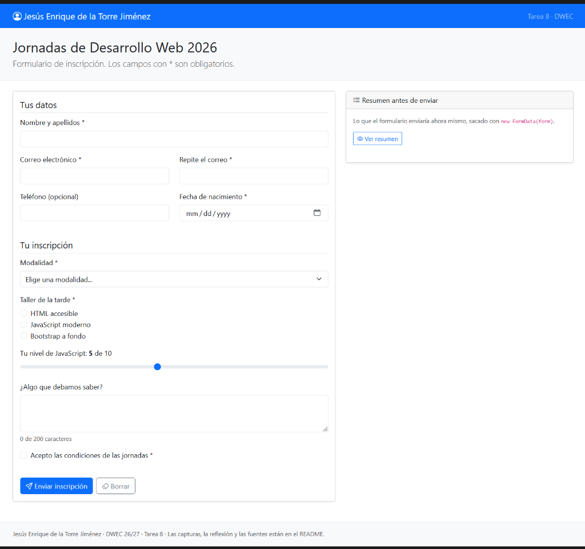
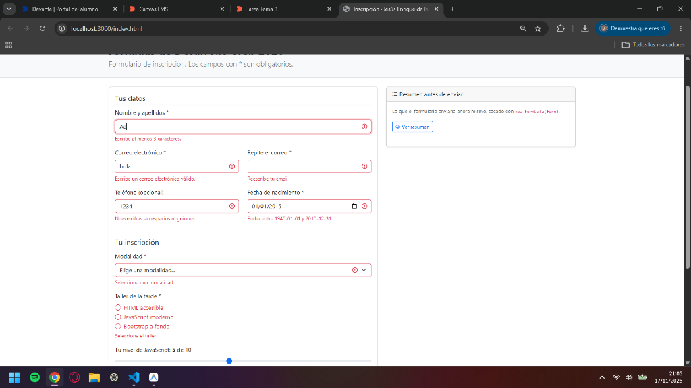
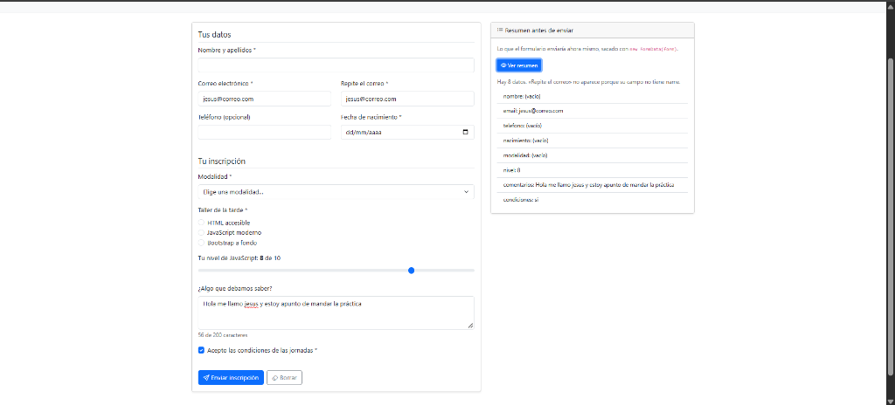

# Tarea 8 · Formulario de inscripción

**Autor:** Jesús Enrique de la Torre Jiménez · Desarrollo Web en Entorno Cliente (DWEC) · 2.º DAW · Curso 2026-27

> **Plantilla de la tarea 8.** Cómo usarla:
>
> 1. Copia esta carpeta en tu repositorio de DWEC y cámbiale el nombre a `tema08`.
> 2. Esta vez el formulario lo maquetas tú: `index.html` solo trae el primer campo, «nombre», como modelo. Los `id` que usa el JavaScript están en el enunciado.
> 3. `js/app.js` trae `mostrarError()` hecha y el resto con `TODO`; `js/recibido.js`, la lectura de un dato como modelo.
> 4. Flechas en los callbacks y, dentro de ellos, `e.target` en vez de `this`. Nada de `alert()`.
> 5. Sustituye las imágenes de `capturas/` por las tuyas, **con el mismo nombre**.
> 6. Todo lo que va entre [corchetes] es un hueco: cámbialo por lo tuyo. Al terminar, borra este aviso.

[Una o dos líneas: qué hay en esta carpeta y cómo se ve. Por ejemplo: abrir la carpeta en VS Code, pulsar **Go Live** y probar el formulario con la consola abierta (F12).]

## Capturas

### a) La página recién cargada

En la captura vemos el nombre y el formulario completo con dos fieldsets.

### b) Ejercicio 2: el mensaje del navegador

El campo que falla es el primero de Nombre y apellidos al ser obligatorio y no estar relleno. Cuando quitamos la propiedad required desde la consola de desarrollador, los datos se envian aun estando vacios. Es por ello que tenemos que siempre validar los datos del servidor ya que las restricciones puestas en el front-end son sujetas a modificaciones por el usuario.

### c) Ejercicio 3: lo que llega por GET

 
Al hacer un GET, se mandan todos los datos del formulario por la URL, a excepción del campo de repetir el correo que lo eliminamos antes de enviarlo. Nunca enviaríamos una contraseña porque sería visible en la barra de direcciones y estaria expuesta a ataques.

### d) Ejercicio 4: los errores, junto a cada campo

[Al menos cuatro errores distintos y de dónde sale cada mensaje.]

### e) Ejercicios 5 y 6: eventos y resumen

[El contador y el nivel después de escribir, el error de los correos y el resumen de FormData.]

## Reflexión
 
Al validar los datos desde JavaScript y no solo con el navegador podemos comprobar antes de enviar al servidor fallos complejos propios del tipo de campo como contraseñas con complejidad y facilitar al usuario introducir datos correctos. Aun así, las verificaciones hechas antes del envio al back-end son para ayudar al usuario y no sirven como comprobación ya que estas puedes ser sujetas a ser editadas por el usuario, insertando datos no validos. 

Si intentamos usar `this` en el manejador del submit usando una función flecha, nos da un fallo. Este tipo de función no puede llamar sus atributos con `this`, hay que utilizar otros metodos de (e) en este caso.

## Uso de IA

Se ha hecho uso de Gemini 3.8 para la elaboración del README, comprobación de posibles errores en el código y como ayuda externa para la realización.
